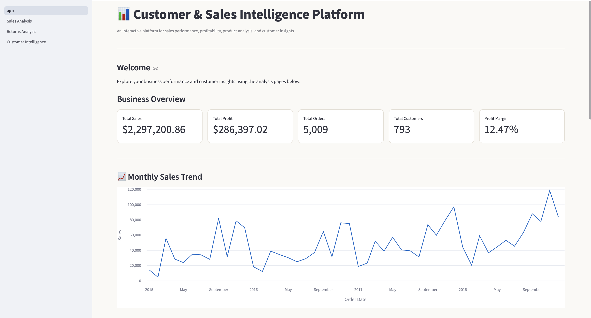
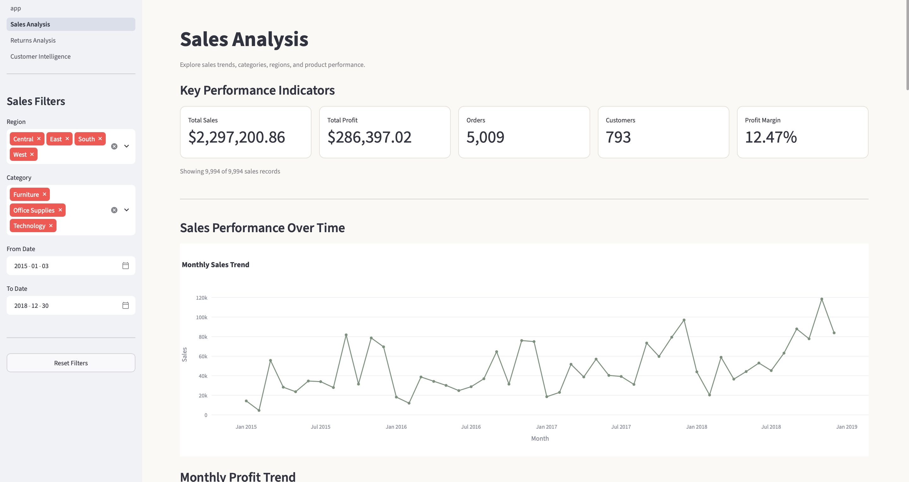
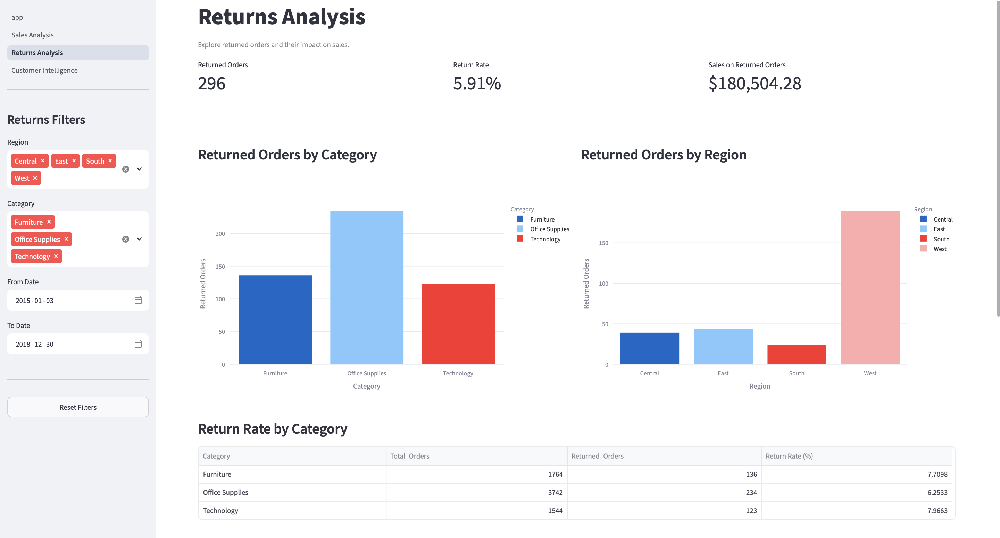
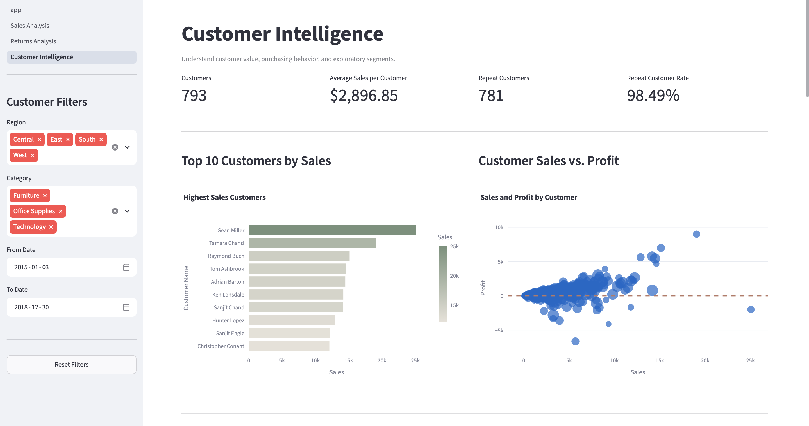

# AI-Powered Customer & Sales Intelligence Platform

An end-to-end Data Analytics and Business Intelligence project that transforms customer and sales data into actionable business insights using SQL, Python, Machine Learning where appropriate, and Microsoft Power BI.

---

## 1. Project Overview

The AI-Powered Customer & Sales Intelligence Platform is an end-to-end business analytics project designed for a retail/e-commerce business.

The platform analyzes sales performance, revenue, profitability, customer behavior, customer segmentation, customer risk, product performance, regional performance, returns, and future sales trends.

The project follows a realistic analytics workflow:

Raw Business Data
        |
        v
Data Validation & Cleaning
        |
        +----------------------+
        |                      |
        v                      v
      MySQL                 Python
        |                      |
        v              +-------+-------+
    SQL Analysis       |       |       |
                       v       v       v
                      EDA     RFM    ML / Forecasting
                       |       |       |
                       +-------+-------+
                               |
                               v
                        Analytical Data
                               |
                               v
                           Power BI
                               |
                               v
                     Business Insights
                               |
                               v
                      Business Decisions

The final Power BI solution will act as the primary business intelligence and visualization layer.

---

## 2. Business Problem

The business has historical customer and sales data but lacks a centralized analytics platform for understanding business performance and customer behavior.

Management needs reliable answers to questions such as:

- How much revenue is the business generating?
- Is revenue growing or declining?
- Which products and categories are most profitable?
- Which regions are performing well?
- Who are the most valuable customers?
- Which customers are at risk of becoming inactive?
- Which customer segments contribute the most revenue?
- How are returns affecting business performance?
- What could sales look like over the next few months?
- What actions should management take based on the analysis?

The goal of this project is to transform raw business data into a structured analytics solution that supports data-driven decision-making.

---

## 3. Project Objectives

The project aims to:

1. Analyze sales and revenue performance.
2. Measure profit and profit margins.
3. Understand customer purchasing behavior.
4. Identify new and returning customers.
5. Segment customers using RFM analysis.
6. Identify customers with potential churn risk.
7. Analyze product and category performance.
8. Compare regional performance.
9. Analyze sales trends and growth.
10. Analyze returns and their business impact.
11. Forecast future sales where the data supports it.
12. Develop an interactive Power BI dashboard.
13. Translate analytical findings into business recommendations.
14. Build a professional portfolio project demonstrating practical Data Analytics and BI skills.

---

## 4. Target Stakeholders

The solution is designed to support multiple business stakeholders.

### CEO / Business Head

Needs:

- Overall business performance
- Revenue and profit trends
- Major opportunities and risks
- High-level KPIs

### Sales Manager

Needs:

- Sales trends
- Regional performance
- Product performance
- Category performance
- Sales growth

### Marketing Manager

Needs:

- Customer segmentation
- Customer value
- Repeat customers
- At-risk customers
- Customer retention opportunities

### Product Manager

Needs:

- Product performance
- Category performance
- High-performing products
- Low-performing products
- Product profitability

### Finance Manager

Needs:

- Revenue
- Profit
- Profit margin
- Discount impact
- Returns
- Profitability trends

### BI / Data Analyst

Needs:

- Detailed analytical data
- SQL analysis
- Customer-level insights
- Data models
- KPIs
- Business intelligence dashboards

---

## 5. Key Business Questions

### Sales Performance

- What is the total revenue?
- How many orders have been placed?
- What is the average order value?
- How does sales performance change over time?
- Which months have the highest and lowest sales?
- How does current performance compare with previous periods?

### Profitability

- What is total profit?
- What is the overall profit margin?
- Which products generate the most profit?
- Which categories have the highest margins?
- Which products generate high revenue but low profit?
- How do discounts affect profitability?

### Customer Analytics

- How many customers does the business have?
- How many customers are repeat customers?
- How many customers are new?
- Which customers contribute the most revenue?
- Which customers purchase most frequently?
- Which customers have high customer value?

### Customer Segmentation

- What customer segments exist?
- Which customers are Champions?
- Which customers are Loyal Customers?
- Which customers are Potential Loyalists?
- Which customers are At Risk?
- Which customers are Lost?
- Which segments generate the most revenue?

### Customer Risk

- Which customers show signs of reduced engagement?
- Which customers may be at risk of churn?
- What percentage of customers are classified as high risk?
- How much revenue is associated with high-risk customers?
- What characteristics are associated with customer risk?

### Product Performance

- Which products generate the most revenue?
- Which products generate the most profit?
- Which products are underperforming?
- Which categories perform best?
- Which categories have weak profitability?

### Regional Performance

- Which regions generate the most revenue?
- Which regions generate the most profit?
- Which regions have the strongest margins?
- Are customer behaviors different across regions?

### Returns

- What percentage of orders or items are returned?
- Which products have the highest return rates?
- Which categories have the highest return rates?
- Are returns affecting profitability?

### Forecasting

- What is the historical sales trend?
- What could sales look like over the next 3–6 months?
- Is the expected trend increasing or decreasing?
- How reliable is the forecasting approach?

---

## 6. Technology Stack

### Database

- MySQL

### SQL

- SELECT
- WHERE
- GROUP BY
- HAVING
- JOINs
- CASE statements
- Common Table Expressions (CTEs)
- Subqueries
- Aggregations
- Date functions
- Window functions
- Ranking
- Running totals
- Month-over-month analysis
- Year-over-year analysis

### Python

- Python
- Pandas
- NumPy
- Matplotlib
- Scikit-learn where appropriate

### Business Intelligence

- Microsoft Power BI
- Power Query
- DAX
- Data modeling
- Star schema
- Time intelligence
- Interactive dashboard design

### Version Control

- Git
- GitHub

---

## 7. Dataset Requirements

The dataset should support an end-to-end retail/e-commerce analytics workflow.

### Required Business Entities

The project should contain or support the following entities:

- Customers
- Orders
- Order Items
- Products
- Categories
- Regions
- Payments
- Returns
- Customer Interactions where appropriate

### Required Customer Information

Examples include:

- Customer ID
- Customer location
- Customer signup/registration date
- Customer status where available

### Required Order Information

Examples include:

- Order ID
- Customer ID
- Order date
- Order status
- Shipping information where available

### Required Order Item Information

Examples include:

- Order ID
- Product ID
- Quantity
- Selling price
- Discount
- Cost
- Revenue
- Profit

### Required Product Information

Examples include:

- Product ID
- Product name
- Category
- Cost
- Price

### Required Time Information

The dataset should contain sufficient historical dates to support:

- Daily analysis
- Monthly analysis
- Yearly analysis
- Year-over-year comparisons
- Month-over-month comparisons
- Trend analysis
- Forecasting

### Dataset Selection Principles

The final dataset should:

1. Have sufficient historical transaction data.
2. Contain customer-level purchase information.
3. Contain product-level information.
4. Contain dates suitable for time-series analysis.
5. Contain sufficient records for meaningful segmentation.
6. Support relational database design.
7. Support SQL business analysis.
8. Support Python exploratory analysis.
9. Support Power BI data modeling.
10. Be large enough to demonstrate practical analytics but manageable on a student laptop.

No dataset will be selected until it has been evaluated against these requirements.

---

## 8. Database Design

The project will use a relational database design in MySQL.

The planned entities include:

Customers
    |
    +---- Orders
             |
             +---- Order Items
                       |
                       +---- Products
                                |
                                +---- Categories

Customers
    |
    +---- Customer Interactions

Orders
    |
    +---- Payments

Order Items
    |
    +---- Returns

Customers
    |
    +---- Regions

The exact schema will be finalized after the dataset has been selected and evaluated.

---

## 9. Planned Data Model

The Power BI model will follow a professional analytical modeling approach, using a star schema where appropriate.

### Fact Tables

Potential fact tables:

- Fact Sales
- Fact Returns
- Fact Payments
- Fact Customer Interactions where appropriate

### Dimension Tables

Potential dimension tables:

- Dim Customer
- Dim Product
- Dim Category
- Dim Region
- Dim Date

The final model will be determined after examining the selected dataset.

---

## 10. SQL Analytics

SQL will be used for business-oriented analysis.

Planned SQL analysis includes:

### Basic Analysis

- Total sales
- Total profit
- Total orders
- Total customers
- Average order value

### Aggregation

- Sales by month
- Sales by region
- Sales by category
- Sales by product
- Profit by category

### Joins

- Customers with orders
- Orders with order items
- Products with categories
- Sales with customer information

### Advanced SQL

- CTEs
- Subqueries
- CASE statements
- Window functions
- Ranking
- Running totals
- Customer purchase frequency
- Month-over-month growth
- Year-over-year growth

The SQL analysis will focus on meaningful business questions rather than demonstrating SQL syntax without business context.

---

## 11. Python Data Cleaning

Python will be used to validate and prepare the data.

Planned cleaning tasks include:

- Missing-value analysis
- Duplicate detection
- Data-type validation
- Date formatting
- Invalid-value detection
- Outlier investigation
- Data consistency checks
- Referential integrity checks
- Revenue validation
- Profit validation

The cleaning process will be documented so that the transformation from raw data to analytical data is reproducible.

---

## 12. Exploratory Data Analysis

Python will be used for exploratory data analysis.

Areas of analysis include:

### Sales

- Sales trends
- Monthly revenue
- Sales distribution
- Growth patterns

### Customers

- Customer purchase frequency
- Customer spending
- Customer distribution
- Repeat purchase behavior

### Products

- Product revenue
- Product profit
- Product quantity
- Product performance

### Categories

- Category revenue
- Category profit
- Category margins

### Regions

- Regional revenue
- Regional profit
- Regional customer behavior

### Returns

- Return frequency
- Return rate
- Product return patterns
- Category return patterns

EDA findings will be used to guide the later Power BI dashboard and business recommendations.

---

## 13. Customer Segmentation — RFM Analysis

Customer segmentation will use RFM analysis.

### Recency

How recently a customer made a purchase.

### Frequency

How frequently a customer purchases.

### Monetary

How much revenue a customer generates.

The three dimensions will be combined to create meaningful customer segments.

Potential segments include:

- Champions
- Loyal Customers
- Potential Loyalists
- At Risk
- Lost Customers

The exact segmentation rules will be defined based on the selected dataset and analyzed customer behavior.

---

## 14. Customer Churn / Risk Analysis

Customer churn prediction will only be implemented if the dataset contains sufficient information to define a meaningful churn or inactivity target.

Potential features may include:

- Recency
- Purchase frequency
- Monetary value
- Average order value
- Number of orders
- Time since previous purchase
- Return behavior
- Customer tenure
- Interaction history where available

Potential output:

- Low Risk
- Medium Risk
- High Risk

If the dataset does not support a reliable churn model, the project will use an explainable customer-risk methodology instead of forcing machine learning into the project.

---

## 15. Machine Learning

Machine learning will be used only when it adds genuine analytical value.

If a churn model is appropriate, the project may include:

- Feature selection
- Target definition
- Train/test split
- Model training
- Model comparison
- Prediction
- Evaluation

Potential evaluation metrics:

- Accuracy
- Precision
- Recall
- F1-score
- Confusion matrix

Model performance and limitations will be documented clearly.

The project will prioritize explainability over unnecessary model complexity.

---

## 16. Sales Forecasting

Sales forecasting will be performed if the dataset contains sufficient historical time-series data.

The forecast may cover approximately:

- 3 months
- 6 months

depending on data availability and quality.

The analysis will include:

- Historical sales
- Sales trend
- Forecast period
- Forecasted revenue
- Actual vs forecast
- Forecast limitations

The forecasting method will be selected based on the characteristics of the available data.

---

## 17. Power BI Dashboard

Power BI will be the primary presentation layer of the project.

The dashboard will contain multiple pages.

### Page 1 — Executive Overview

KPIs:

- Total Revenue
- Total Profit
- Profit Margin
- Total Orders
- Total Customers
- Average Order Value
- YoY Growth

Visualizations:

- Revenue trend
- Profit trend
- Sales by region
- Sales by category
- Top products
- Key business insights

Filters:

- Year
- Region
- Category
- Customer Segment

### Page 2 — Sales Intelligence

The page will analyze:

- Monthly sales
- YoY growth
- MoM growth
- Revenue by category
- Revenue by region
- Top 10 products
- Bottom 10 products
- Profitability

### Page 3 — Customer Analytics

The page will show:

- Customer count
- Customer segments
- RFM analysis
- Repeat customers
- New vs returning customers
- Customer contribution to revenue
- Customer value indicators

### Page 4 — Customer Churn / Risk

The page will show, where supported:

- High-risk customers
- Medium-risk customers
- Low-risk customers
- Churn probability
- Revenue at risk
- Customer characteristics associated with risk

### Page 5 — Sales Forecasting

The page will show:

- Historical sales
- Forecasted sales
- Forecast period
- Expected revenue
- Trend
- Actual vs forecast

### Page 6 — Business Insights & Recommendations

The page will translate analytical findings into business decisions.

The intended approach is:

Finding
    |
    v
Business Explanation
    |
    v
Potential Business Impact
    |
    v
Recommended Action

Example:

Finding:
Revenue increased but profit margin declined.

Potential Explanation:
Discounting increased in a low-margin category.

Recommendation:
Review discounting strategy and prioritize higher-margin products.

Actual findings will only be added after analysis is completed.

---

## 18. Power BI Technical Implementation

The project will demonstrate:

- Power Query
- Data cleaning
- Data transformation
- Data modeling
- Star schema
- Fact tables
- Dimension tables
- Relationships
- Date table
- DAX measures
- Time intelligence
- KPI cards
- Slicers
- Drill-through
- Tooltips
- Bookmarks
- Conditional formatting
- Dynamic titles
- Interactive filtering

---

## 19. Planned DAX Measures

The project will include business-focused DAX measures such as:

- Total Sales
- Total Profit
- Profit Margin
- Total Orders
- Total Customers
- Average Order Value
- Previous Year Sales
- YoY Growth
- MoM Growth
- Running Total
- Customer Count
- Repeat Customer Rate

Each important measure will be documented and explained.

---

## 20. Business Insights

This section will be updated after completing the analysis.

Planned insight categories include:

### Sales Insights

To be determined from actual analysis.

### Customer Insights

To be determined from actual analysis.

### Product Insights

To be determined from actual analysis.

### Regional Insights

To be determined from actual analysis.

### Profitability Insights

To be determined from actual analysis.

### Risk Insights

To be determined from actual analysis.

### Forecasting Insights

To be determined from actual analysis.

No business result will be invented or reported before it is calculated from the project data.

---

## 21. Business Recommendations

Recommendations will be based on actual analytical findings.

Potential recommendation areas include:

- Customer retention
- Product strategy
- Pricing and discounting
- Regional strategy
- Marketing targeting
- Inventory priorities
- Profitability improvement

Final recommendations will be added after completing the analysis.

---

## 22. Project Architecture

Customer_Sales_Intelligence_Project/
|
├── 01_Data/
│   ├── raw/
│   ├── cleaned/
│   └── README.md
│
├── 02_SQL/
│   ├── schema/
│   ├── queries/
│   ├── analysis/
│   └── README.md
│
├── 03_Python/
│   ├── notebooks/
│   ├── scripts/
│   └── README.md
│
├── 04_PowerBI/
│   ├── dashboard/
│   └── README.md
│
├── 05_Documentation/
│   ├── project_notes.md
│   ├── data_dictionary.md
│   ├── architecture.md
│   └── business_insights.md
│
├── 06_Screenshots/
│
├── 07_Resume_LinkedIn/
│
└── README.md

---

## 23. Documentation

The project documentation will include:

- Problem statement
- Project objectives
- Business questions
- Dataset description
- Data dictionary
- Database schema
- Data model
- Architecture
- SQL analysis
- Python analysis
- RFM methodology
- Churn methodology
- Forecasting methodology
- Power BI documentation
- Key findings
- Business recommendations
- Limitations
- Future improvements

---

## 24. Project Status

| Component | Status |
|---|---|
| Project definition | Completed |
| Project folder structure | Completed |
| README | In Progress |
| Dataset selection | Not Started |
| Dataset validation | Not Started |
| Database design | Not Started |
| MySQL setup | Not Started |
| Data loading | Not Started |
| SQL analysis | Not Started |
| Python environment | Not Started |
| Data cleaning | Not Started |
| Exploratory Data Analysis | Not Started |
| RFM segmentation | Not Started |
| Churn / risk analysis | Not Started |
| Sales forecasting | Not Started |
| Power BI data model | Not Started |
| DAX measures | Not Started |
| Power BI dashboard | Not Started |
| Business insights | Not Started |
| Business recommendations | Not Started |
| Documentation | Not Started |
| GitHub packaging | Not Started |
| Resume preparation | Not Started |
| LinkedIn preparation | Not Started |
| Interview preparation | Not Started |

---

## 25. Limitations

The following limitations will be evaluated after the dataset and analytical methods are finalized:

- Dataset quality and completeness
- Missing values
- Historical data availability
- Customer churn definition
- Forecasting accuracy
- Machine learning model limitations
- Potential data bias
- Synthetic or derived data, if used

Limitations will be documented honestly based on the actual project implementation.

---

## 26. Future Improvements

Potential future improvements include:

- Real-time sales monitoring
- Automated data pipelines
- Cloud database integration
- Automated dashboard refresh
- Advanced customer lifetime value modeling
- Improved churn prediction
- Advanced forecasting models
- Marketing campaign optimization
- Recommendation systems
- Automated business alerts

Future improvements will only be listed when they are relevant to the completed project.

---

## 27. Key Findings

This section will be completed after the SQL, Python, machine learning, forecasting, and Power BI analysis.

The project will document measurable findings based on the actual dataset.

---

## 28. Dashboard Screenshots

Dashboard screenshots will be added here after the Power BI dashboard has been completed.

---

## 29. Resume Highlights

Resume bullet points will be created after the project is completed.

They will be based on actual technical work and measurable project results.

No unsupported or fabricated metrics will be included.

---

## 30. LinkedIn Project

The LinkedIn project description and project post will be created after the project has been completed.

---

## 31. Interview Preparation

The completed project will be used to prepare for technical and business analytics interviews covering:

### SQL

- Joins
- Aggregations
- CTEs
- Window functions
- Subqueries
- Business analysis

### Python

- Pandas
- NumPy
- Data cleaning
- EDA
- RFM analysis
- Machine learning

### Power BI

- Power Query
- Data modeling
- Star schema
- Relationships
- DAX
- Time intelligence
- Dashboard design

### Business Analytics

- KPI selection
- Business questions
- Insight generation
- Business recommendations
- Analytical decision-making

---

## 32. Project Goal

The final objective is to create a professional portfolio project that demonstrates the ability to:

Understand a Business Problem
          |
          v
Acquire and Validate Data
          |
          v
Clean and Prepare Data
          |
          v
Design a Database
          |
          v
Perform SQL Analysis
          |
          v
Perform Python Analysis
          |
          v
Build Explainable Analytics / ML
          |
          v
Build Power BI Data Model
          |
          v
Create Interactive Dashboards
          |
          v
Generate Business Insights
          |
          v
Recommend Business Actions

The project will prioritize practical, explainable analytics and genuine business value over unnecessary technical complexity.

All reported results will be based on actual analysis performed during the project.
---

## Dashboard Preview

### 1. Home Dashboard

### 2. Sales Analysis

### 3. Returns Analysis

### 4. Customer Intelligence

